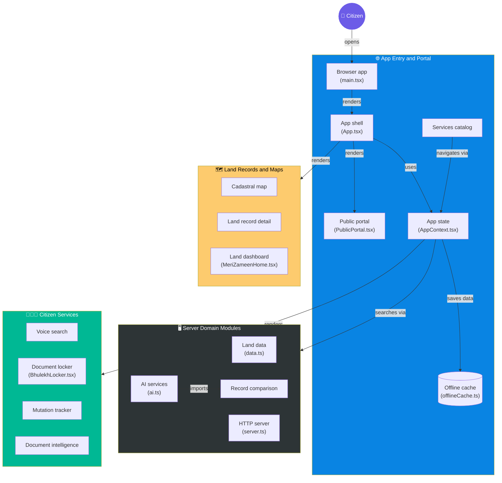

<div align="center">

# **🌍 BHOOMI-SEVAK**

**AI-Native Web Portal for Land Records & Citizen Services**

> *"Empowering citizens with transparent, intelligent, and accessible land record management."*

<br/>


</div>

---

## **📑 Table of Contents**

| | Section | | Section |
| :---: | :--- | :---: | :--- |
| 🎯 | [Overview](#-overview) | 🏗️ | [Architecture](#️-architecture) |
| ✨ | [Key Features](#-key-features) | 🧱 | [Tech Stack](#-tech-stack) |
| 📁 | [Project Structure](#-project-structure) | 🚀 | [Getting Started](#-getting-started) |
| 🧠 | [AI & Comparison Engine](#-ai--comparison-engine) | 🛡️ | [Privacy & Security](#️-privacy--security) |

---

## **🎯 Overview**

**Bhoomi-Sevak** is a Progressive Web App (PWA) designed to act as a modern, AI-assisted bridge between citizens and complex land record systems. Moving beyond the traditional mobile-only approach, Bhoomi-Sevak offers a highly accessible web portal with offline capabilities, voice search, and intelligent document comparison.

It replaces bureaucratic friction with a transparent, user-centric interface for searching cadastral maps, tracking mutations, and understanding land data.

---

## **🏗️ Architecture**

Bhoomi-Sevak utilizes a robust, modular architecture separating the server domain, app entry, and citizen-facing services.



---

## **✨ Key Features**

### **🧑‍🤝‍🧑 Citizen Services**
*   **🎙️ Voice Search:** Query land records using natural speech, breaking down literacy and typing barriers.
*   **📁 Document Locker (`BhulekhLocker.tsx`):** A secure digital vault for citizens to store and retrieve their land documents.
*   **🔄 Mutation Tracker:** Real-time status updates on land mutation applications.
*   **🧠 Document Intelligence:** AI-driven extraction of key data points from uploaded land documents.

### **🗺️ Land Records & Maps**
*   **🗺️ Cadastral Map:** Interactive mapping of land parcels and boundaries.
*   **📄 Land Record Detail:** Deep-dive view of RoR (Record of Rights) data.
*   **📊 Land Dashboard (`MeriZameenHome.tsx`):** A unified, personalized dashboard for citizens to view all their land holdings at a glance.

### **⚙️ System Capabilities**
*   **📴 Offline-First Caching:** Utilizes `offlineCache.ts` and Service Workers (`sw.js`) so users can access previously viewed records without an internet connection.
*   **⚖️ Record Comparison:** Automatically detects and highlights discrepancies between old and new land records.

---

## **🧱 Tech Stack**

<div align="center">


</div>

<br/>

| &nbsp; | **Layer** | **Technology** | **Purpose** |
| :---: | :--- | :--- | :--- |
| ⚛️ | **Frontend** | **React + TypeScript** | Component-driven UI with strict type safety |
| ⚡ | **Build Tool** | **Vite** | Lightning-fast HMR and optimized production builds |
| 📦 | **Runtime/Pkg** | **Bun** | Ultra-fast package manager and script runner (`bun.lock`) |
| 🛰️ | **Backend** | **Node/Bun Server** | Custom HTTP server (`server.ts`) for API and AI routing |
| 📱 | **PWA** | **Service Worker** (`sw.js`) | Offline caching and native-like installation |
| 🤖 | **AI Layer** | **Gemini/Custom AI** | Document parsing and intelligent record comparison |

---

## **📁 Project Structure**

```text
bhoomi-sevak/
│
├── 📂 public/                 # Static assets & PWA Service Worker
│   ├── 🖼️ images/             # Logos, icons, and static UI graphics
│   └── ⚙️ sw.js               # Service Worker for offline caching
│
├── 📂 server/                 # Server domain logic
│   ├── 🤖 ai.ts               # AI service integration (Gemini, etc.)
│   ├── ⚖️ comparisonEngine.ts # Logic for diffing land records
│   └── 🗄️ data.ts             # Land data models & mock DB
│
├── 📂 src/                    # React Frontend Application
│   ├── 🧩 components/         # Reusable UI (MeriZameenHome, BhulekhLocker, etc.)
│   ├── 🌐 context/            # React Context (AppContext.tsx for global state)
│   ├── 🛠️ utils/              # Helper functions
│   ├── 🎨 App.tsx             # App shell & routing layout
│   ├── 🚀 main.tsx            # React DOM entry point
│   ├── 📝 types.ts            # Global TypeScript interfaces
│   └── 🎨 index.css           # Global styles
│
├── 🔑 .env.example            # Environment variables template
├── 📦 bun.lock                # Bun lockfile
├── 📄 index.html              # Vite HTML entry
├── 📜 package.json            # Dependencies & scripts
├── ⚙️ server.ts               # HTTP Server entry point
├── 🔧 tsconfig.json           # TypeScript configuration
└── 🚀 vite.config.ts          # Vite bundler configuration
```

---

## **🚀 Getting Started**

### **① Prerequisites**
Ensure you have **Bun** (recommended) or **Node.js** installed.

```bash
# Install Bun (if you haven't already)
curl -fsSL https://bun.sh/install | bash
```

### **② Clone & Install**
```bash
git clone https://github.com/Aluro7in/bhoomi-sevak.git
cd bhoomi-sevak

# Install dependencies using Bun
bun install
```

### **③ Environment Setup**
Copy the example environment file and add your API keys.
```bash
cp .env.example .env
```
*(Edit `.env` to include your Gemini API key or other required secrets)*

### **④ Run the App**
```bash
# Start the Vite frontend
bun run dev

# In a separate terminal, start the backend server
bun run server.ts
```

### **⑤ Build for Production**
```bash
bun run build
```

---

## **🧠 AI & Comparison Engine**

Bhoomi-Sevak uses a hybrid AI approach. 

1.  **Document Intelligence (`ai.ts`)**: Extracts text and structured data from uploaded PDFs/images using vision models.
2.  **Comparison Engine (`comparisonEngine.ts`)**: Compares historic land records with newly fetched data to identify discrepancies (e.g., boundary changes, ownership transfers) and flags them for the citizen.
3.  **Offline Cache (`offlineCache.ts`)**: Ensures that AI-generated summaries of land records are saved locally via the Service Worker so citizens in low-connectivity areas can still read them.

---

## **🛡️ Privacy & Security**

> ⚠️ **Data Sensitivity**
> Land records contain PII (Personally Identifiable Information).

*   **Local-First Processing:** Where possible, record comparisons are done locally or via secure server endpoints.
*   **No Unencrypted AI Egress:** Sensitive data is stripped of direct identifiers before being sent to LLM providers.
*   **Offline Safety:** Cached data in the browser is secured via standard web storage practices and can be manually cleared by the user via the UI.

---

<div align="center">

## **🌍 BHOOMI-SEVAK**

*Transparent Land Records for Every Citizen.*

[](../../issues)
[](../../issues)

<sub>Built with ⚡ Bun, React, and a mission for transparent governance.</sub>

</div>
